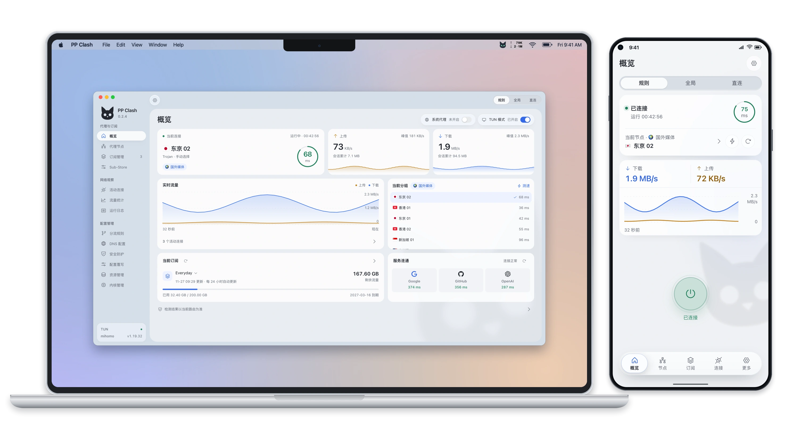
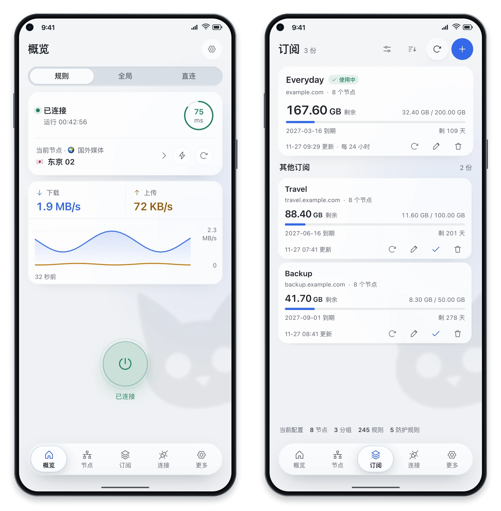

  <picture>
    <source media="(prefers-color-scheme: dark)" srcset="assets/readme/logo-dark.svg">
    
  </picture>

<h1 align="center">PP Clash</h1>

<strong>A mihomo client for desktop and Android. Your connections at a glance.</strong>

<a href="README.md">English</a> · <a href="README.zh-CN.md">简体中文</a>

  
  
  
  
  

> **Important — PP Clash does not provide proxy servers or subscription services.** Bring your own subscription or configuration file.

<a href="#features">Features</a> · <a href="#android">Android</a> · <a href="#downloads">Downloads</a> · <a href="#security">Security</a>

  <picture>
    <source media="(prefers-color-scheme: dark)" srcset="assets/readme/showcase-dark.webp">
    
  </picture>

0.2.4 desktop and Android UI · Captured from the app's development preview with demo data; illustrated device frames.

## Features

- **Subscriptions and nodes.** Import subscriptions or local configs, compare latency, and view usage and expiry dates. Node selections are remembered between sessions.
- **Subscription collections.** Use the built-in Sub-Store service to combine sources, filter or rename nodes, run processing scripts, preview results, and export or apply a collection.
- **Encrypted backups.** Back up subscriptions, node selections, overrides, and Sub-Store data to your own WebDAV server. Preview a backup before restoring it on another device.
- **Traffic and routing.** View active connections, rules, DNS, and logs. Choose Rule, Global, or Direct mode; use System Proxy or TUN on desktop and the system VPN on Android.
- **Desktop and mobile controls.** A compact tray panel on desktop and touch controls on Android, with light, dark, and system themes. Manage routing resources on both; manage mihomo versions and YAML or JavaScript overrides on desktop.

In Sub-Store, select **Batch operations** to show row checkboxes for actions on multiple items. They stay hidden during normal browsing.

WebDAV server passwords and backup passphrases are separate. Keep your backup passphrase: you need it to restore an encrypted backup.

## Android

A layout made for your phone: check your current node, tap the latency ring to test it, and connect with one large control. Live traffic stays in view; subscriptions have quick actions for updating, editing, and switching. Routing databases are bundled, so the first subscription import does not need to download them separately.

Android includes Sub-Store, encrypted WebDAV backup and restore, routing resource updates, and credential storage through Android Keystore.

  <picture>
    <source media="(prefers-color-scheme: dark)" srcset="assets/readme/android-dark.webp">
    
  </picture>

Android overview and subscriptions · Development preview with demo data.

**Available for Android 7.0+ on 64-bit devices.** ARM64 has been tested on an Android 13 phone; x86_64 has been tested in an Android 15 emulator. Both test environments use 4 KiB memory pages. Android 7.0 and devices using 16 KiB pages have build and alignment checks, but no runtime validation yet.

## Downloads

Download packages from the [latest release](https://github.com/JasperPengC/pp-clash/releases/latest). Choose the package that matches your operating system and processor:

| Platform | Package |
| :--- | :--- |
| macOS · Intel | DMG · x86_64 |
| macOS · Apple silicon | DMG · aarch64 (ARM64) |
| Windows · x64 | Setup · amd64 |
| Windows · ARM64 | Setup · ARM64 |
| Linux · x64 / ARM64 | `.deb`, `.rpm`, or `.AppImage` |
| Android · ARM64 / x86_64 | APK · arm64-v8a / x86_64 |

macOS requires version 13.5 or later. macOS Intel and Windows x64 have been tested on physical devices; Linux x64 has runtime validation, and Linux ARM64 has QEMU validation. Apple silicon and Windows ARM64 still need runtime testing on target devices; Linux ARM64 has not been tested on physical hardware.

On Linux, PP Clash requires WebKitGTK 4.1 and Ayatana AppIndicator. AppImage packages still use the host system's GTK and WebKitGTK libraries.

Opening on macOS for the first time

Current macOS packages use a local signature and are not notarized by Apple. If macOS blocks the app, open System Settings → Privacy & Security and choose **Open Anyway** for PP Clash.

To get started, import your subscription or local config and choose a node. On desktop, enable System Proxy or TUN. On Android, tap the connection button and allow the system VPN request.

For Android updates, use packages signed with the same release certificate. Local test APKs use a different certificate and cannot replace the official release. Save your subscriptions and configuration before switching between those channels.

The official 0.2.3 → 0.2.4 upgrade has been verified in the x86_64 emulator, preserving subscriptions and backup settings. See the [0.2.4 release notes](https://github.com/JasperPengC/pp-clash/releases/tag/v0.2.4) for this release's changes.

## Security

DNS and WebRTC protection are part of the default configuration: encrypted DNS, rule-aware DNS resolution, and Fake-IP, with IPv6 disabled. In Rule mode, PP Clash also adds STUN blocking rules. The desktop Security page checks the running DNS and STUN setup and can test WebRTC candidates inside the app.

Desktop System Proxy does not capture UDP traffic; use TUN for UDP traffic used by WebRTC and similar protocols. Android uses the system VPN service. These protections depend on the active configuration and traffic being captured; they do not guarantee that every browser, application, or network path is leak-free.

Sub-Store processing scripts run in a local Node.js service with file and network access. Only run scripts you trust.

## Build and release checks

The build toolchain uses Node.js 24.18.0, Go 1.27.4, Rust 1.100.0, and JDK 17. Run `bash scripts/ci.sh preflight` before a release to check versions, public files, secrets, workflows, and offline build tests.

CI rebuilds Sub-Store from pinned source and locked dependencies, then prepares Node.js for each desktop test or installer target. Android application builds download the verified ARM64 and x86_64 Node.js runtimes pinned in the [artifact lock](scripts/sub-store/android-runtime-artifacts-lock.json), instead of recompiling Node.js for every release. Downloaded or cached runtimes still undergo input, resource checksum, ELF, API level, and 16 KiB alignment checks. Official Android packages also require release certificate verification.

The separate [Android Node runtime dependency workflow](.github/workflows/android-runtime.yml) builds both runtimes from pinned source when that dependency needs updating. Its dependency releases do not replace the latest application release.

Manual Release workflow runs build artifacts by default. Publishing requires a matching application version tag and an explicit publish option; pushing a version tag also starts the release process.

## About

PP Clash uses [mihomo](https://github.com/MetaCubeX/mihomo) as its proxy core and is built with Tauri, Rust, React, and TypeScript.

Licensed under [AGPL-3.0-only](LICENSE). Third-party notices are available in [THIRD_PARTY_NOTICES.md](THIRD_PARTY_NOTICES.md).
