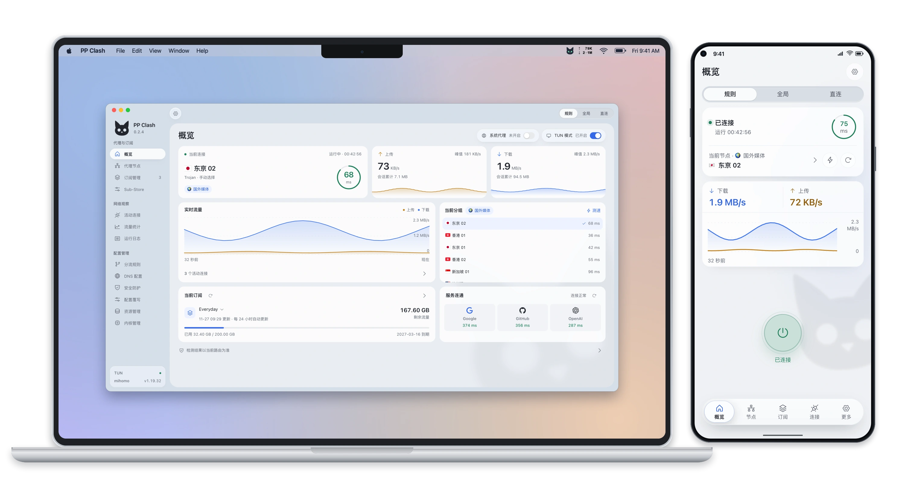
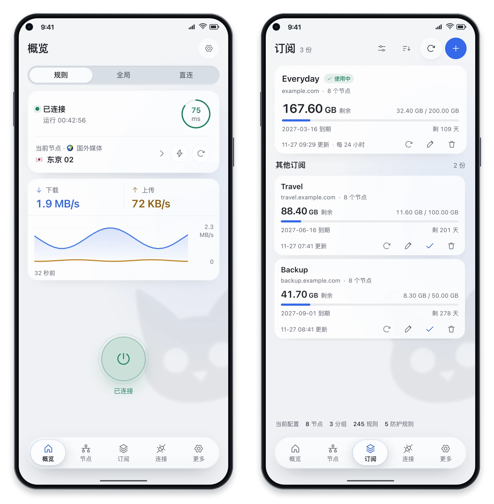

  <picture>
    <source media="(prefers-color-scheme: dark)" srcset="assets/readme/logo-dark.svg">
    
  </picture>

<h1 align="center">PP Clash</h1>

<strong>为桌面与 Android 打造的 mihomo 客户端，连接状态一目了然。</strong>

<a href="README.md">English</a> · <a href="README.zh-CN.md">简体中文</a>

  
  
  
  
  

> **重要：PP Clash 不提供代理节点或订阅服务。** 请自行准备订阅或配置文件。

<a href="#功能">功能</a> · <a href="#android">Android</a> · <a href="#下载安装">下载安装</a> · <a href="#安全防护">安全防护</a>

  <picture>
    <source media="(prefers-color-scheme: dark)" srcset="assets/readme/showcase-dark.webp">
    
  </picture>

0.2.4 桌面与 Android 界面 · 从应用开发预览截取，使用演示数据与绘制的设备外框。

## 功能

- **订阅与节点。** 导入订阅或本地配置，比较节点延迟，查看用量与到期时间。再次打开应用时，会记住上次选择的节点。
- **订阅组合。** 内置 Sub-Store 服务，支持合并来源、筛选与重命名节点、运行处理脚本、预览结果，以及导出或应用组合。
- **加密备份。** 将订阅、节点选择、覆写和 Sub-Store 数据备份到自己的 WebDAV 服务器，在其他设备恢复前可先预览备份内容。
- **流量与分流。** 查看活动连接、分流规则、DNS 和运行日志。支持规则、全局和直连模式；桌面端使用系统代理与 TUN，Android 使用系统 VPN。
- **桌面与移动操作。** 桌面端有菜单栏快捷面板，Android 使用触控布局，均支持浅色、深色和跟随系统主题。两端可管理分流资源；桌面端还可管理 mihomo 内核版本、编辑 YAML 或 JavaScript 覆写。

Sub-Store 中点击“批量操作”后才会显示行复选框，用于同时操作多条内容，平时默认收起。

WebDAV 服务器密码与备份口令分别设置。请妥善保存备份口令，恢复加密备份时需要使用。

## Android

为手机重新安排操作：看一眼当前节点，点延迟圆环测速，用大按钮连接。实时流量始终可见，订阅的更新、编辑和切换也都放在顺手的位置。分流数据库随应用内置，首次导入订阅无需额外下载。

Android 同样提供 Sub-Store、WebDAV 加密备份与恢复、分流资源更新，并通过 Android Keystore 保存凭据。

  <picture>
    <source media="(prefers-color-scheme: dark)" srcset="assets/readme/android-dark.webp">
    
  </picture>

Android 概览与订阅管理 · 开发预览界面，使用演示数据。

**支持 Android 7.0 及以上的 64 位设备。** ARM64 已在 Android 13 手机上验证；x86_64 已在 Android 15 模拟器验证。两种测试环境均使用 4 KiB 内存页；Android 7.0 和 16 KiB 页设备目前只有构建与对齐检查，尚无运行验证。

## 下载安装

从[最新 Release](https://github.com/JasperPengC/pp-clash/releases/latest) 下载，根据操作系统和处理器架构选择安装包：

| 平台 | 安装包 |
| :--- | :--- |
| macOS · Intel | DMG · x86_64 |
| macOS · Apple 芯片 | DMG · aarch64（ARM64） |
| Windows · x64 | 安装程序 · amd64 |
| Windows · ARM64 | 安装程序 · ARM64 |
| Linux · x64 / ARM64 | `.deb`、`.rpm` 或 `.AppImage` |
| Android · ARM64 / x86_64 | APK · arm64-v8a / x86_64 |

macOS 需要 13.5 或更高版本。目前已完成 macOS Intel 和 Windows x64 实机测试；Linux x64 已完成运行验证，Linux ARM64 已在 QEMU 中验证。Apple 芯片和 Windows ARM64 尚待目标设备运行测试，Linux ARM64 尚无物理设备测试。

Linux 需要 WebKitGTK 4.1 和 Ayatana AppIndicator。AppImage 仍使用系统提供的 GTK 和 WebKitGTK 库。

macOS 首次打开

当前 macOS 安装包使用本地签名，尚未完成 Apple 公证。如果系统阻止打开，请在“系统设置 → 隐私与安全性”中找到 PP Clash，选择**仍要打开**。

首次使用时，导入自己的订阅或本地配置并选择节点。桌面端按需开启系统代理或 TUN；Android 点击连接按钮，并允许系统 VPN 授权。

Android 更新需要使用相同正式证书签名的安装包。本地测试 APK 使用另一张证书，不能覆盖正式版；切换渠道前请先保存订阅和配置。

正式版 0.2.3 → 0.2.4 覆盖升级已在 x86_64 模拟器验证，订阅和备份设置均保留。本次变更见 [0.2.4 发布说明](https://github.com/JasperPengC/pp-clash/releases/tag/v0.2.4)。

## 安全防护

DNS 与 WebRTC 防护已纳入默认配置：启用加密 DNS、按规则解析和 Fake-IP，并关闭 IPv6。规则模式下还会加入 STUN 阻断规则。桌面端安全页面可以检查当前运行中的 DNS 与 STUN 设置，并在应用内检测 WebRTC 候选。

桌面端系统代理不接管 UDP，WebRTC 等协议使用的 UDP 流量需要通过 TUN 接管；Android 使用系统 VPN 服务。这些防护取决于实际生效的配置和流量接管情况，不代表所有浏览器、应用或网络路径都不会泄漏。

Sub-Store 处理脚本在本地 Node.js 服务中运行，具有文件和网络访问能力，请只运行可信来源的脚本。

## 构建与发布检查

构建工具链使用 Node.js 24.18.0、Go 1.27.4、Rust 1.100.0 和 JDK 17。发布前运行 `bash scripts/ci.sh preflight`，检查版本、公开文件、敏感信息、工作流和离线构建测试。

CI 从固定源码和依赖锁重建 Sub-Store 引擎，桌面测试及安装包按目标架构准备 Node.js。Android 应用构建从[产物锁文件](scripts/sub-store/android-runtime-artifacts-lock.json)下载已验证的 ARM64 与 x86_64 Node.js 运行时，无需每次发布重新编译 Node.js。下载或缓存恢复后仍会检查构建输入、资源摘要、ELF、API 级别和 16 KiB 对齐。正式 Android 包还须通过签名证书校验。

需要更新该依赖时，由独立的 [Android Node 运行时依赖工作流](.github/workflows/android-runtime.yml)从固定源码构建两种运行时。依赖 Release 不会替代应用的最新版本入口。

手动运行 Release 工作流默认只构建。公开发布需要匹配应用版本的 `v` 标签，并明确启用发布选项；推送版本标签也会进入发布流程。

## 关于

代理核心使用 [mihomo](https://github.com/MetaCubeX/mihomo)，应用基于 Tauri、Rust、React 和 TypeScript 构建。

项目采用 [AGPL-3.0-only](LICENSE) 许可证。第三方组件许可信息见 [THIRD_PARTY_NOTICES.md](THIRD_PARTY_NOTICES.md)。
